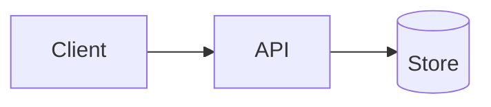

# Documentation that publishes cleanly on purview.dev

purview.dev does not host your documentation; it **reads it out of your repository** at build time
and publishes it at `https://purview.dev/docs/<project-id>/`. The same Markdown is also read on
GitHub. Every rule here keeps one file correct in both places, with no site configuration in your
repository.

The site's catalogue entry for your project (in `purview-dev/purview-dev`,
`src/src/data/projects/<id>.yml`) decides **which** files are read — `docs.source`, `docs.path`,
`docs.rootPage`, `docs.exclude`. This repository decides **what they say and where they sit**.

## The rules

| # | Rule | Why |
| - | - | - |
| 1 | Docs live in `docs/wiki/` (or `docs/`), as plain `.md` files. No `mkdocs.yml`, theme or plugin list. | The site renders; the repository only writes. A site file is ignored and drifts. |
| 2 | **Hierarchical, not flat**: one lower-case topic folder per area (`guide/`, `configuration/`, `reference/`). Only the landing page, `Home.md`, `_Sidebar.md` and pages the catalogue deep-links stay at the root. | A folder is a sidebar group and a URL segment: `guide/Getting-Started.md` → `/docs/<id>/guide/getting-started/`. Twenty files in one folder is a list nobody scans. |
| 3 | File and folder names: letters, digits, single dashes (`Custom-Rules.md`). | The path *is* the URL, lower-cased; anything else is rewritten, and a name that reduces to nothing fails the sync. |
| 4 | Exactly one `# Title` per page, first; then one paragraph saying what the page answers. | The H1 is the page title and sidebar label; the first paragraph is the meta description (160 chars). |
| 5 | Relative links, resolved from the file they are in (`../reference/Options.md`, `Sibling.md#anchor`). | The site rewrites them to its own URLs; a link outside the docs folder becomes a GitHub link. |
| 6 | Relative images (`./images/flow.png`); badges may stay absolute. | Relative images are served from GitHub raw at the channel's ref. |
| 7 | Every fence declares a language (`csharp`, `json`, `shell`, `text`). | An unlabelled fence loses highlighting on both sides. |
| 8 | Callouts use GitHub alerts: `> [!NOTE]`, `> [!TIP]`, `> [!IMPORTANT]`, `> [!WARNING]`, `> [!CAUTION]`. | They become Starlight asides on the site and render natively on GitHub. |
| 9 | **Diagrams are never ASCII art.** A diagram is a LikeC4 model paired with a Mermaid fence (below). | ASCII art is unreadable on a phone, unsearchable, and drifts silently. |
| 10 | Moving or renaming a page adds a line to `_redirects.yml` in the same commit. | The old URL is in bookmarks, search results and other repositories. |
| 11 | `_Sidebar.md` lists every page once, grouped by section, in reading order. | The site orders pages by it; a page missing from it has no place in the navigation. |

Full layout rules, a worked tree and what the site rewrites: [references/layout.md](references/layout.md).

## Hierarchy: the default shape

```text
docs/wiki/
  _Sidebar.md                 navigation (not published)
  _redirects.yml              moves (not published)
  Home.md                     hub / landing page (docs.rootPage)
  Getting-Started.md          root only because the catalogue deep-links it
  guide/
    README.md                 the folder's own page: /docs/<id>/guide/
    Installation.md
    First-Project.md
  configuration/
    Options.md
    Environment-Variables.md
  diagrams/
    request-flow.c4           LikeC4 models (not published as pages)
```

One level of folders is the default; go deeper only when a folder holds a sub-area with several pages
of its own. A nested `README.md` (or `index.md`) is that folder's landing page. A page the site's
catalogue deep-links from a use case (`useCases[].docsPage`) is a single URL segment, so it must stay
at the root until the catalogue entry moves with it — check the entry before moving one.

## Diagrams: LikeC4 on the site, Mermaid on GitHub

Draw each diagram once as a LikeC4 model in a `.c4` file, and once as Mermaid for GitHub. Wrap the
Mermaid fence in the `purview:likec4` markers:

````markdown
<!-- purview:likec4 file="./diagrams/request-flow.c4" view="requestFlow" title="Request flow" -->


[LikeC4 model](./diagrams/request-flow.c4)
<!-- /purview:likec4 -->
````

- **On GitHub** the comments are invisible: the reader sees the Mermaid diagram and a link to the model.
- **On purview.dev** the sync replaces the whole block — markers, Mermaid and link — with the LikeC4
  view, rendered interactively. The Mermaid is never shown there.
- If the model cannot be read or does not declare the view, the site keeps the Mermaid and the sync
  logs a warning, so a mistake costs fidelity, never the page.

Marker options, the model rules (one self-contained file per diagram), and a full worked conversion of an
ASCII flow: [references/diagrams.md](references/diagrams.md).

## Moving pages: `_redirects.yml`

```yaml
# docs/wiki/_redirects.yml — previous: current (slugs, or paths from the docs root)
redirects:
  getting-started: guide/getting-started
  Custom-Rules.md: schemas/Custom-Rules.md
```

The site reads the file at each documentation channel's own ref and writes a redirect page for every
pair whose destination exists and whose source is no longer a page. A pair whose destination is missing,
or whose source still exists, is reported and skipped; an invalid file fails the site's sync with the
file name, so fix it rather than delete it. Never remove a line once released — the old URL lives in
someone's bookmark. Details: [references/redirects.md](references/redirects.md).

## Moving a page — the checklist

1. `git mv` the file, so history follows it.
2. Fix every inbound link: other pages (relative to *their* folder), `_Sidebar.md`, `Home.md`, the
   READMEs, `AGENTS.md`, skills, and tests that name the path.
3. Add `old-slug: new/slug` to `_redirects.yml`.
4. If the page is a catalogue deep link (`docsPage`), it stays at the root, or ask the site maintainers
   to move the deep link; do not edit `purview-dev/purview-dev` unasked.
5. Run the assessment (`purview-site-assessment`) and fix what it reports.

## Related skills

- `purview-site-integration` — everything else the site reads from a repository (topics, releases,
  packages, skills) and how a project joins the catalogue.
- `purview-site-assessment` — a script and a procedure that check a repository against these rules.
