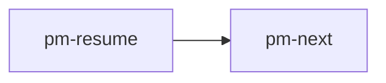
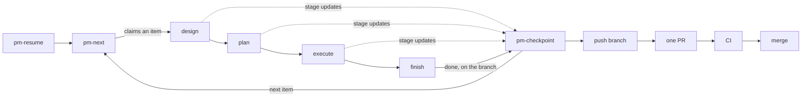

# Diagrams: a LikeC4 model paired with a Mermaid fence

GitHub renders Mermaid and shows LikeC4 as source. purview.dev renders LikeC4 (interactive, with the
model behind it) and Mermaid. A diagram pair gives each reader the best diagram their renderer can show,
from one page.

## The block

````markdown
<!-- purview:likec4 file="./diagrams/the-loop.c4" view="theLoop" title="The loop" -->


[LikeC4 model](./diagrams/the-loop.c4)
<!-- /purview:likec4 -->
````

| Part | Rule |
| -- | -- |
| Opening marker | `<!-- purview:likec4 … -->` alone on its line |
| `file` | **required.** The `.c4` model, relative to the page (or `/`-rooted at the repository root). It may live anywhere in the repository, including outside the docs folder |
| `view` | the view to render; defaults to the first view the model declares. Name it explicitly |
| `title`, `description` | the heading and sub-heading of the diagram on the site |
| `height` | pixels, default `420` |
| `collapsible`, `defaultOpen` | `true`/`false`; the site's diagram shell is collapsible and open by default |
| Between the markers | what GitHub shows: one ```` ```mermaid ```` fence, then optionally a link to the model |
| Closing marker | `<!-- /purview:likec4 -->` alone on its line |

Markers inside a code fence are ignored (that is how this page shows them).

## What happens

| Reader | Sees |
| -- | -- |
| GitHub | the Mermaid diagram and the "LikeC4 model" link; the comments are invisible |
| purview.dev | the LikeC4 view only. The sync swaps the whole block for a ```` ```likec4 ```` fence holding the model file's text |
| purview.dev, model unreadable or view undeclared | the Mermaid diagram, and a warning in the site's sync log naming the page, line and reason |

## The model file

- **One self-contained file per diagram**: its own `specification`, `model` and `views`. The site
  compiles the file on its own, so it cannot see other `.c4` files — no shared specification across
  files, no `import`.
- Keep models beside the docs (`docs/wiki/diagrams/<name>.c4`). A `.c4` file is never published as a
  page.
- Element and view ids: letters, digits, underscores, starting with a letter (`theLoop`, `apiGateway`).
- Validate before committing: `npx likec4 validate docs/wiki/diagrams` (or `bunx likec4 validate …`).
- Prefer `autoLayout LeftRight` for flows and `TopBottom` for hierarchies; `include *` for a small model.

## The Mermaid rendering

- It is the GitHub reader's diagram, so keep it equivalent: the same nodes and edges, the same labels.
  It does not need the styling or descriptions the model carries.
- `flowchart LR`/`TB` for flows; `sequenceDiagram` when the LikeC4 view is a `dynamic view`.
- When the model changes, the Mermaid changes in the same commit — review them side by side.

## Never ASCII art

A fenced ```` ```text ```` block of boxes and arrows is a diagram nobody can read on a phone, search,
or keep in step. Convert it. A legend that sits under ASCII art ("pm-park: any time, capture only")
becomes a table or a list after the diagram, not part of it.

## Worked conversion

The PM skills README describes its loop as ASCII art:

```text
pm-resume -> pm-next -> [design -> plan -> execute -> finish]
                ^            |            |           |
                |     pm-checkpoint (stage updates)  pm-checkpoint (done, on the branch)
                |                                         |
                +-----------------------------------------+
                                                          |
                                          push branch -> one PR -> CI -> merge
```

**1. The model** — `docs/diagrams/the-loop.c4`:

```likec4
specification {
  element skill {
    style {
      shape rectangle
    }
  }
  element stage {
    style {
      shape rectangle
      color secondary
    }
  }
  element delivery {
    style {
      shape rectangle
      color muted
    }
  }
}

model {
  resume = skill 'pm-resume' {
    description 'Reads the planning files and recommends one action'
  }
  next = skill 'pm-next' {
    description 'Claims the first item that is still the right one'
  }
  design = stage 'design'
  plan = stage 'plan'
  execute = stage 'execute'
  finish = stage 'finish'
  checkpoint = skill 'pm-checkpoint' {
    description 'Writes where work stopped, so a compacted session can resume'
  }
  push = delivery 'push branch'
  pr = delivery 'one PR'
  ci = delivery 'CI'
  merge = delivery 'merge'

  resume -> next
  next -> design 'claims an item'
  design -> plan
  plan -> execute
  execute -> finish
  design -> checkpoint 'stage updates'
  plan -> checkpoint 'stage updates'
  execute -> checkpoint 'stage updates'
  finish -> checkpoint 'done, on the branch'
  checkpoint -> next 'next item'
  checkpoint -> push
  push -> pr
  pr -> ci
  ci -> merge
}

views {
  view theLoop {
    title 'The loop'
    include *
    autoLayout LeftRight
  }
}
```

**2. The README section**:

````markdown
## The loop

<!-- purview:likec4 file="./docs/diagrams/the-loop.c4" view="theLoop" title="The loop" -->


[LikeC4 model](./docs/diagrams/the-loop.c4)
<!-- /purview:likec4 -->

| Skill | When it runs |
| -- | -- |
| `pm-park` | any time, capture only |
| `pm-review` | weekly |
| `pm-risk` | capture a risk any time; manage the register when no workflow is active |
````

The file path is relative to the page, so from the root `README.md` it is `./docs/diagrams/the-loop.c4`;
from `docs/wiki/guide/Loop.md` it would be `../../diagrams/the-loop.c4`.
